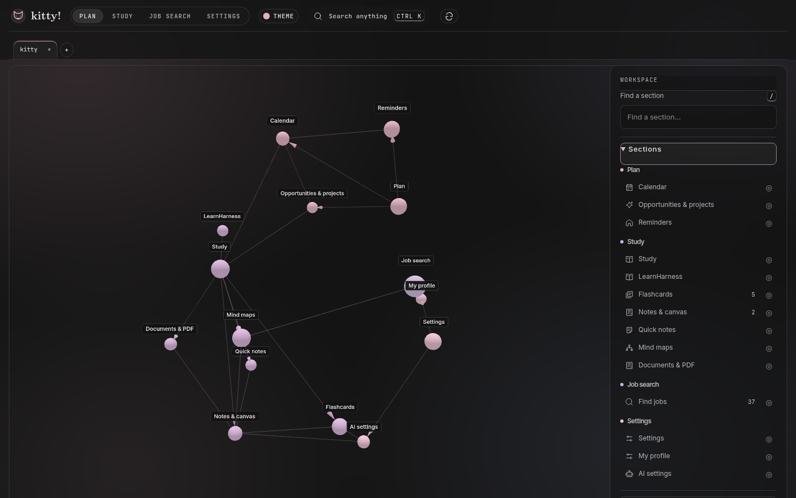
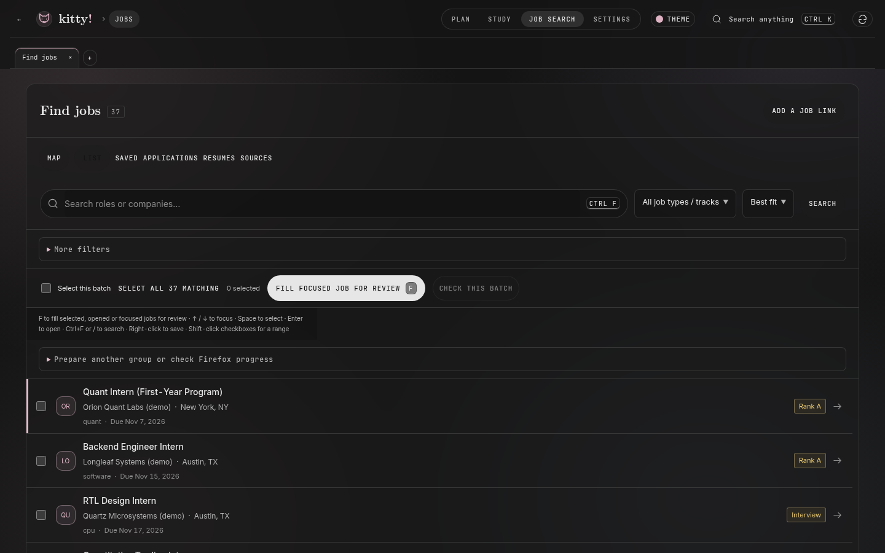
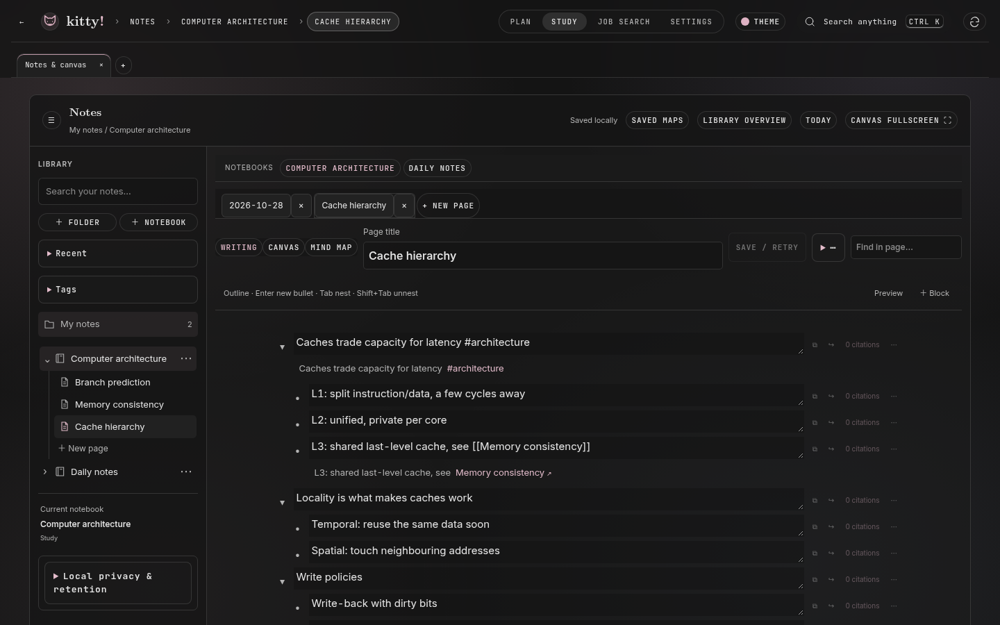
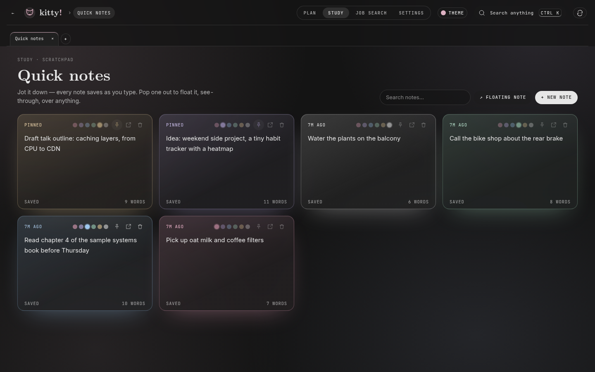
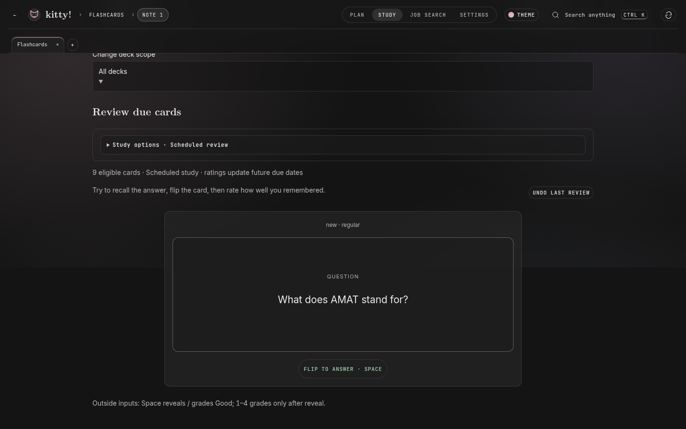
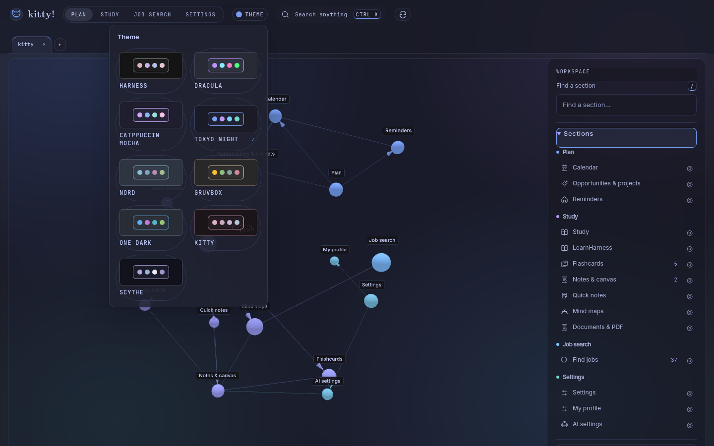

# kitty! desktop downloads

Official Linux x86_64 installers and signed update metadata. Application source is maintained in a separate private repository.

[Download the latest release](https://github.com/ZacharySF/kitty-releases/releases/latest). Install the `.deb` using your software installer, or use the AppImage. Open kitty! from the application launcher. Use **Check for updates** inside the desktop app for signed updates.

Your workspace is stored separately from the application and retained across updates. Never share your workspace, credentials, resumes or private database in an issue.

## Screenshots

These screenshots use synthetic sample data only.

**Home:** the workspace map links every section, with a section list beside it.

**Find jobs:** search, filter and sort job listings, then prepare selected applications for review.

**Notes:** notebooks of outline pages with tags and `[[page]]` links.

**Quick notes:** a board of tinted scratch notes that can be pinned or popped out.

**Flashcards:** decks with scheduled review.

**Themes:** pick a color theme from the toolbar; Tokyo Night is shown here.

